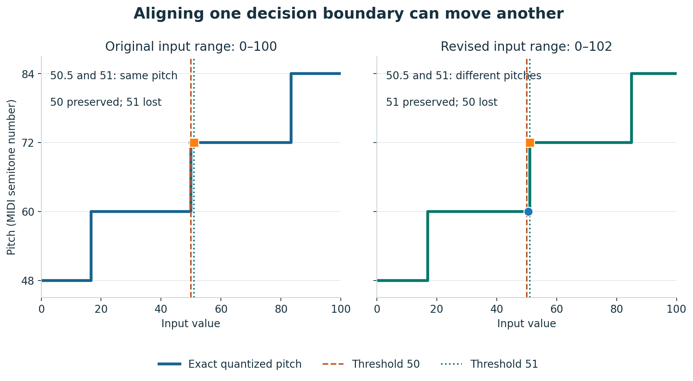
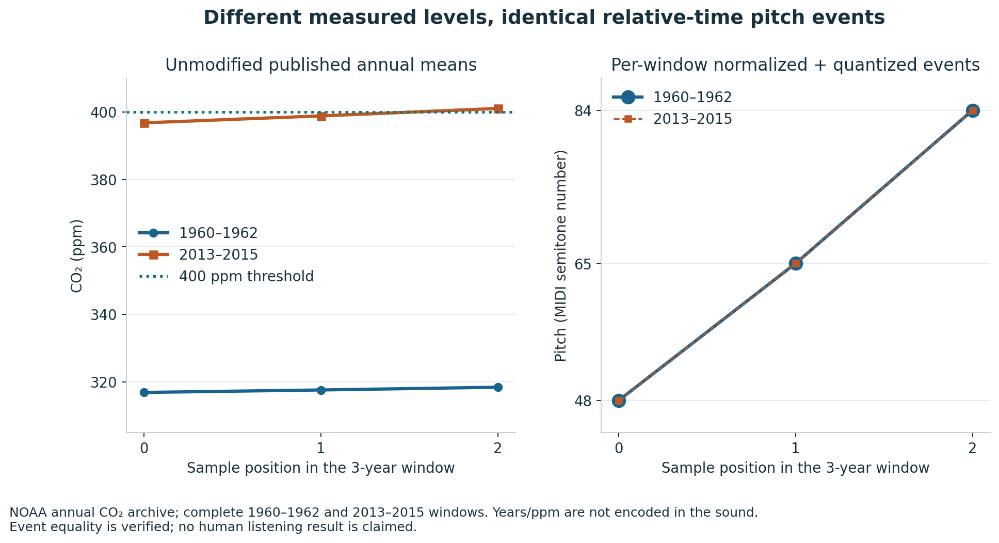
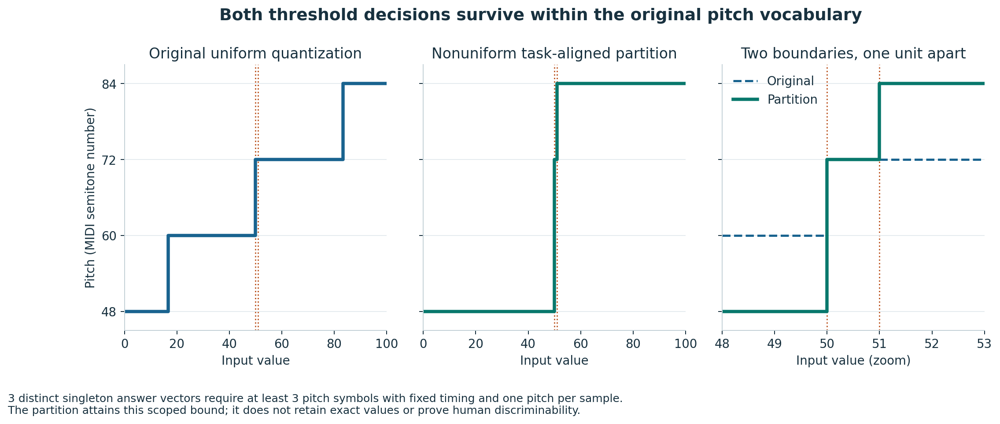
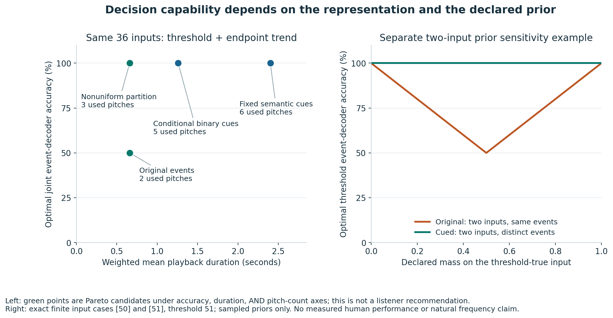
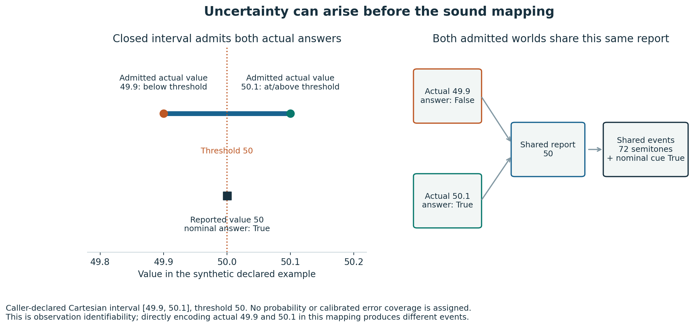

# EchoProof：声音图表需要保留哪些答案？

## 已完成的成果

EchoProof 是一个零第三方 Python 运行依赖的研究原型：先指定数据问题，再搜索不同数据是否产生完全相同的声音事件但不同答案；保存可以重算的反例，并检查修复方案。它包括五类映射机制、有限输入穷举、连续实数区间阈值证书、CSV 候选检查、实际 Erie 编译记录、两种补充答案提示，以及带副作用的范围修复。

原创候选是组合后的可复验软件工作流。公开检索没有识别出完全相同的成品；这不能证明全球没人开发。信息论、量化损失、听觉提示和任务相关评估已有大量前人工作。来源与读取边界保存在 [调研记录](PRIOR_ART.md)。

## 三个有用的发现

### 同样的步长，可以保留一个阈值而丢失另一个

范围 0–100、音域宽度 3,600 cents、步长 1,200 cents、最近邻量化且平局向上时，切换边界在 50/3、50、250/3。阈值 50 的 inclusive 判断被保留；51 的判断则被丢失。这不是“步长粗就一定错”：关键是问题边界是否与声音切换边界对齐。

对任意输入长度，只要没有缺失或漏采样，每个数值来自 0–100 闭实数区间，上述两个结论成立于本工具的精确事件语言。证书同时保存了假设与可重算反例，见 [50](../artifacts/threshold50.json)、[51](../artifacts/threshold51.json)。

### 单项修复可能损害另一项；有些约束必须改变

保持音域和步长不变时，把上限从 100 调为 102，可以让阈值 51 落在切换边界上。这是两个单端点修改族中端点改动量最小的候选，但阈值 50 因而不再保留。

若原始范围 0–100 仍必须被覆盖，相邻声音边界间距至少为 100/3。因此 50 与 51 无法同时成为不同边界。工具保存这项模型内的不可行证书；不能把它外推成任何非线性、多声部或带语音设计都不可行。相反，15、51、87 可以通过范围 −3..105 同时保留。见 [修复报告](../artifacts/threshold51-alignment/index.html)。

### 部分声音通道冲突，不代表完整图表冲突

直接运行官方 Erie 1.0.1 编译器，对数值 1、2、3 构成的全部三点序列，共 27 个原始输入保存编译队列。

| 规范与范围 | 输出类别 | 阈值 3 冲突对 | 首尾趋势冲突对 | 峰值位置冲突对 |
| --- | ---: | ---: | ---: | ---: |
| 自动范围，完整队列保留语音 | 27 | 0 | 0 | 0 |
| 同一规范，只取离散纯音流 | 13 | 14 | 0 | 0 |
| 平均值汇总，完整队列 | 8 | 12 | 41 | 49 |

前两行说明语音图例会改变判断。第三行说明“原始数据有没有尖峰”和“只播放平均值”可能不兼容，但汇总有意丢掉细节，不自动意味着 Erie 有 bug。8 个平均值输出类别包括浮点汇总顺序造成的微小差异；没有把它们悄悄合并成数学上理想的 7 类。

记录复验只检查已保存队列和原始任务答案，明确输出 `RECORDING_VERIFIED (backend not rerun)`；需要重新调用外部后端时应使用锁定的接入脚本。

## 第二后端的受控映射核对

锁定官方 Highcharts 13.1.1 源码，调用原始内部映射函数及 18 个原始辅助模块，手动提供 point、数据极值和捕获通道。27 个三点序列（49、50、51）共 8 种乐器参数／时间输出；阈值 50 冲突 0 对，51 冲突 19 对，趋势 25 对、峰值位置 42 对、总和 40 对。这只检验受控映射函数，没有构造 Chart、全时间线或播放器。

常数序列映射到最小音高，和核心模型的中点规则不同。此差异明确说明：模型证书不能自动当作第三方实现证书。原始参数中的音符数也是 C0 偏移，不应混同为本工具的 MIDI cents。具体输入、极值和 source 哈希均保存；见 [第二接入说明](../integrations/highcharts/README.md)。

## 有限网格安全，不等于连续数据安全

对固定范围、有限量化步长、无缺失且不漏采样的单音高映射，任意非零宽度的输入区间中总有不同数值映射到同一音高。由该量化单元内的两个精确有理数 a<b，构造 `[a,b]` 与 `[b,a]`，声音逐事件相等而首尾趋势与峰位不同；`[a]` 与 `[b]` 的总和也不同。

工具已经能对每项任务保存连续区间证书，包含两端截断与边界情况。即使量化步长缩至 1 cent，这些任务仍有连续域冲突。这是已知有限量化原理的具体构造，不是新理论。它说明有限网格上的更细步长修复不能被包装成完整连续域保证。额外的任务答案通道改变假设，因而不受同一限制。见 [连续任务报告](../artifacts/continuous-tasks/index.html)。

## 两段未经改动的真实观测

[NOAA 原始年度 CO₂ 数据](https://gml.noaa.gov/webdata/ccgg/trends/co2/co2_annmean_mlo.csv)存档包括 1959–2025 的 67 个年度平均值，提取全部 65 个完整三年窗口，没有改写观测。逐窗口归一化与 100 cents 量化后，事件分为 15 类，400 ppm 阈值有 49 对冲突；其中 1960–1962 的 `[316.91,317.64,318.45]` 与 2013–2015 的 `[396.74,398.81,401.01]` 声音事件完全相同而阈值答案相反。

窗口均按相同相对时间播放，不编码绝对年份或 ppm。原文件注释、单位、数据归属、测站变更说明及 SHA-256 保留，选出的完整窗口逐年对原始存档核对；见 [可听案例](../artifacts/noaa-windows/index.html)。这不表明完整现实气候图表丢失了这些信息，也没有经过真人听觉实验。

审计保留缩减前的原始输入对和删除点后的短反例。两者分别验证，不能用短反例冒充完整观测窗口。

图中的线连接离散采样点；没有生成连续滑音。原始 ppm 不同，右侧事件音高完全重合。

## 构造性修复

有限域二进制提示只补足原始声音类别里有歧义的联合答案。量化案例最大含 8 种联合答案，3 位达到条件固定长度二进制计数下界，但要查该原始声音类别的码本，且下界不包含分隔符成本。

固定语义提示则始终使用同一组词汇：阈值用两音上／下行，趋势用上行、下行、同音重复或专用未定义模式。它直接编码计算出的答案，保留原始事件，支持原声明网格以外的有限输入；当前两项任务增加 1,740 毫秒。已对归一化案例全部 36 个输入验证机器解码，零失败。它不宣称最短，也不能声称真人听起来容易懂。

## 从机器证明走向实验材料

已准备两个条件的匹配材料：4 个声音歧义组、10 个原始案例，每种任务答案等次数出现。40 个试次 WAV、6 个训练图例、隐藏答案的参与者表、独立研究者键和原始来源审计都可以重新生成、逐字节核对。每个参与者只接触一个条件，研究方案需要在收集前固定训练、随机分配和结果指标。提示本身可听，不声称条件盲法。

这只是材料准备，没有招募、观测、生成或分析真人结果。完整操作与限制在 [协议](../artifacts/study-kit/PROTOCOL.md)。不能把机器可解码或不同WAV字节转述为真人更易学。

## 验证与未完成事项

174 项自动检查通过。核心映射另有 10,000 次独立数值参考对照和 50,000 次任务答案对照；多阈值修复另有 3,000 次独立边界配对对照，无差异。完整平台、种子、指纹与性能记录见 [验证记录](VALIDATION.md)。

没有开展真人听觉实验、真实无障碍用户测试或 Web Audio 播放验证。应用浏览器拒绝本地文件 URL，本次没有绕过，故 HTML 只有链接、音频及标签结构检查，没有视觉验收。声音事件不同也不意味着人耳能区分。

没有发布网站、推送远程仓库或向相关作者发送消息。成果全部在本地，MIT 许可。

## 相同音高词汇，另一种映射可同时保留判断

等距线性范围保留原覆盖范围、音域和 1200 cents 步长时，50/51 同时保留不可行。但非均匀三段分区 `[0,50)`、`[50,51)`、`[51,100]` 分别使用 4800、7200、8400 cents 可以保留两项判断，不增加采样音符、时间或原有音高词汇。当前实现提供整个闭区间的事件级证书和严格机器解码。原来的 50/51 单点生成相同 PCM，新表示生成不同 PCM。

三个不同单点答案向量要求至少三个符号，这一计数下界限定固定时间且每点一个音、无其他通道。构造达到该下界，属于标准原理的可执行应用，不是新数学定理，不意味音高选择最利于人耳识别。见 [对照与证书](../artifacts/partition-thresholds/index.html)。

## 类别数量不能替代任务保真

另一个固定映射实验对全部65个未经改动的NOAA三年窗口运行：原范围310–430 ppm、1200 cents步长与非均匀350/400/420 ppm分区，两者都形成10个声音事件类别，也都使用四个相同音高。但前者在350/400/420的采样位置与计数上分别有179/53/9对同声音不同答案，后者均为0，所有65窗机器解码正确。原始与新映射产生一样多的声音类别，也可能保留完全不同的任务信息；不据此声称总体熵相等。

[全部窗口、音频和存档一致性证据](../artifacts/noaa-partition/index.html)保留完整年份和值、双侧事件、阈值profile、原文件哈希和三组未经缩减的对照窗口。计数是原年度均值采样的计数，不能解释为暴露时间或风险，也未做真人辨别实验。

## 冲突与决策困难不是同一个数

36个等权量化案例输入里，原事件仅允许理想解码器在1/3输入上同时答对阈值、趋势和峰位；条件二进制提示允许1。若统一只问阈值与首尾趋势，则原事件上限1/2，条件二进制提示、固定语义提示和非均匀分区均达到1。平均时长660/1260/2400/660 ms，使用音高数2/5/6/3；见[完整同域比较](../artifacts/decision-comparison/index.html)。这都是精确事件与所选有限先验下的计数，不是参与者正确率。

另取两个相同原事件的输入[50]、[51]，问是否达到51：等权先验下上限1/2；声明权重99:1后上限99/100。更高上限并没有消除冲突；它来自更强的不平衡先验。该例原事件不增加决策信息，无事件的最佳基线等于它的最佳事件解码正确率。

左图三轴前沿计算另计音高数量，因此原事件与分区都在前沿。有限网格上分区恢复趋势不能推及连续输入；图不是人在实际声音中的识别效果。

## 输入观测已不确定时，正确的名义提示也不能确定实际真假

合成例报告值50、声明实际区间[49.9,50.1]，问实际值是否≥50。上下界分别false/true，而播放同一报告及其名义true提示会产生相同WAV。原等距声音映射在直接输入实际49.9/50.1时其实能分开两者；因此这次问题在报告观测之前，不能误称为原声音映射事件碰撞。

模块返回确定真、确定假或不可确定，保存全部区间组合可行的假设、端点世界和计数界。没有先验概率，不将不可确定称为50%；没有从NOAA误差列推导保证区间。见[四种合成情形](../artifacts/observation-uncertainty/index.html)。

## 将范围、问题和修复放进同一份可重放报告

新的[诊断入口](../artifacts/diagnosis-cases/index.html)不要求手工拼接多个证书命令。六例分别检查50/51联合约束、51修复回归、逐序列标尺、漏采样、实际观测未知与单音高容量不足。旧有原边界的丢失对单端点、联合端点及非均匀分区都计算；范围搜索超限保留为未搜索。

数值-only契约由常量判断、逐序列单点反例、固定标尺遗漏第二点反例和旧线性证书组合覆盖当前全部Mapping变体。它的闭实数输入范围不包含缺失、其他任务、人耳或来源真实性。诊断尤其不将“当前实际问题未知”替换成可修复的名义音高问题。
